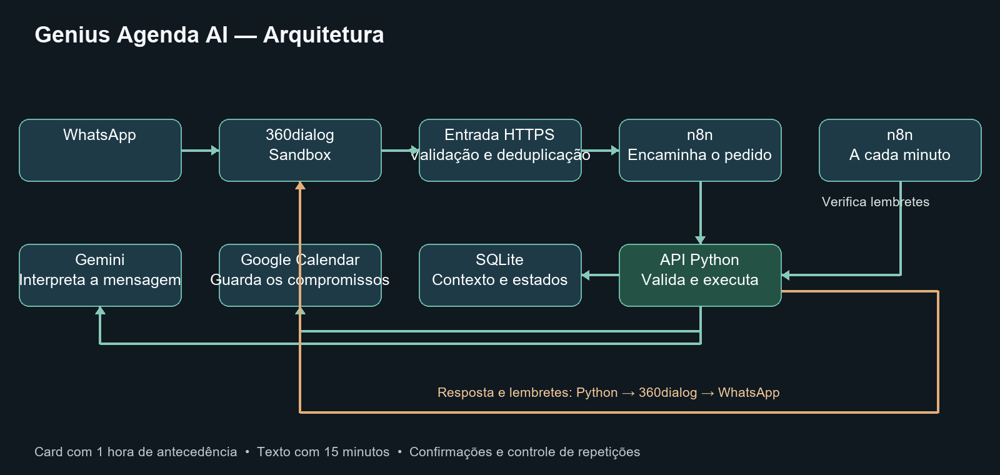

# Genius Agenda AI

Assistente pelo WhatsApp para organizar entrevistas no Google Calendar, com contexto de conversa, confirmações, lembretes e preparo. Projeto desenvolvido para o Desafio Genius Agenda AI.

## O que funciona

- Criar, consultar, editar, reagendar e excluir eventos pelo WhatsApp.
- Validar datas, fusos, conflitos e pedidos repetidos; confirmar o evento e a alteração antes das operações que exigem aprovação.
- Enviar card com 1 hora de antecedência e texto com 15 minutos. Estado persistente, sincronização de alterações e bloqueio de resultados incertos.
- Resumos de semana/mês, horários livres, briefing e checklist factual.
- Fundo de IA reutilizável, com título, data e horário inseridos por Python.

**Validação real concluída:** criação, consulta, edição, reagendamento e exclusão no WhatsApp; card de 1 hora e texto de 15 minutos recebidos. O evento de teste foi removido e seu aviso futuro cancelado. [Resultados e limites](docs/fechamento-etapa-16.md).

## Arquitetura



Python/FastAPI, SQLite, Google Calendar API, Gemini API, n8n em Docker e sandbox 360dialog. A interpretação do modelo não substitui validação, confirmação ou execução local. [Arquitetura e estados](docs/arquitetura.md).

## Executar localmente

Ambiente validado em Windows com Python 3.14 e Docker Desktop. Na raiz do projeto:

```powershell
python -m venv .venv
.\.venv\Scripts\python.exe -m pip install -r requirements.txt
if (-not (Test-Path -LiteralPath '.env')) { Copy-Item .env.example .env }
docker compose up -d
.\.venv\Scripts\python.exe -m app
```

API: <http://localhost:8000/health> · Documentação: <http://localhost:8000/docs> · n8n: <http://localhost:5678>.

Configure a chave da API, OAuth Google, Gemini, destinatário autorizado e callback HTTPS nos arquivos privados, seguindo os guias. O endpoint de saúde sozinho não prova que essas integrações foram configuradas. Nunca publique `.env`, tokens, bancos ou capturas pessoais.

- [Configuração e OAuth](docs/configuracao.md)
- [Agente no WhatsApp](docs/whatsapp-agente.md)
- [Fluxos e operação do n8n](n8n/README.md)
- [Lembretes e recuperação](docs/fechamento-etapa-12.md)
- [Resumos e preparo](docs/fechamento-etapa-13.md)
- [Cards: reprodução e limites](docs/cards-com-ia.md)

## Testes e evidências

```powershell
.\.venv\Scripts\python.exe -m unittest discover -s tests
```

Última suíte completa anterior às correções finais: **2.394 testes Python aprovados**. Correções finais: **360 testes focados aprovados**. **981 verificações JavaScript históricas**; os conjuntos não são somados.

O acervo local conserva **173 registros: 44 imagens e 129 JSON**. Capturas originais, testes automatizados, aceites do provedor e recebimento humano são provas distintas. [Índice público dos resultados](docs/evidencias.md) · [Ensaio real](docs/ensaio-real-whatsapp.md).

## Limitações

Ambiente de teste local, com um destinatário no sandbox. Serviços e computador precisam permanecer ligados; túneis de teste são temporários. Fora da janela do canal, faltam templates contextuais de produção. A interpretação pode pedir esclarecimentos; dados ambíguos e estados incertos não autorizam repetição automática. O painel web ficou adiado para priorizar validação e vídeo.

## Entrega

Etapas 1–14 e 16 concluídas no escopo documentado. Próxima: vídeo e conferência final da entrega. [Roteiro curto](docs/roteiro-video.md) · [Fechamento da qualidade](docs/fechamento-etapa-16.md).
