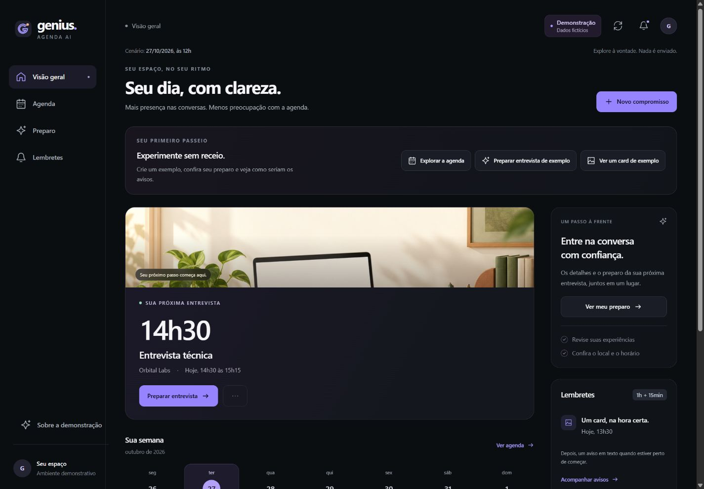

# Genius Agenda AI

Assistente pelo WhatsApp e por um painel web para organizar entrevistas no Google Calendar, com contexto de conversa, confirmações, lembretes e preparo. Projeto desenvolvido para o Desafio Genius Agenda AI.

## O que funciona

- Criar, consultar, editar, reagendar e excluir eventos pelo WhatsApp.
- Localizar compromissos pelo nome para editar, reagendar ou excluir; esclarecer nomes repetidos. Gemini interpreta frases variadas e escolhe a operação.
- Validar datas, fusos, conflitos e pedidos repetidos; confirmar o evento e a alteração antes das operações que exigem aprovação.
- Enviar card com 1 hora de antecedência e texto com 15 minutos. Estado persistente, sincronização de alterações e bloqueio de resultados incertos.
- Resumos de semana/mês, horários livres, briefing e checklist factual.
- Fundo de IA reutilizável, com título, data e horário inseridos por Python.

**Validação real concluída:** criação, consulta, edição, reagendamento e exclusão no WhatsApp; card de 1 hora e texto de 15 minutos recebidos. O evento de teste foi removido e seu aviso futuro cancelado. [Resultados e limites](docs/fechamento-etapa-16.md).

## Arquitetura


Python/FastAPI, SQLite, Google Calendar API, Gemini API, n8n em Docker e sandbox 360dialog. A interpretação do modelo não substitui validação, confirmação ou execução local. [Arquitetura e estados](docs/arquitetura.md).

## Executar localmente

Ambiente validado em Windows com Python 3.14 e Docker Desktop. Na raiz do projeto:

```powershell
python -m venv .venv
.\.venv\Scripts\python.exe -m pip install -r requirements.txt
if (-not (Test-Path -LiteralPath '.env')) { Copy-Item .env.example .env }
docker compose up -d
.\.venv\Scripts\python.exe -m app
```

API: <http://localhost:8000/health> · Documentação: <http://localhost:8000/docs> · n8n: <http://localhost:5678>.

Configure a chave da API, OAuth Google, Gemini, destinatário autorizado e callback HTTPS nos arquivos privados, seguindo os guias. O endpoint de saúde sozinho não prova que essas integrações foram configuradas. Nunca publique `.env`, tokens, bancos ou capturas pessoais.

- [Configuração e OAuth](docs/configuracao.md)
- [Agente no WhatsApp](docs/whatsapp-agente.md)
- [Fluxos e operação do n8n](n8n/README.md)
- [Lembretes e recuperação](docs/fechamento-etapa-12.md)
- [Resumos e preparo](docs/fechamento-etapa-13.md)
- [Cards: reprodução e limites](docs/cards-com-ia.md)

## Painel web

Visão geral, Agenda, Preparo e Lembretes em uma interface responsiva. **Agenda, detalhes e histórico dos lembretes consultam dados reais; o CRUD pelo painel exige prévia e confirmação**, com sessão local protegida e chaves somente no servidor. [Acesso e segurança](docs/painel-web-api.md) · [Telas e funcionamento](docs/painel-web.md).

Com a API ligada, abra <http://127.0.0.1:8000/painel/> e autorize o navegador pelo comando exibido. O **modo demonstração** fica em <http://127.0.0.1:8000/painel/demo/>, sem login: simule operações, preparo e avisos com dados fictícios; restaure os exemplos a qualquer momento. Também funciona sozinho na porta 8015 com `scripts/preview_panel.py`. [Explorar sem acessar a agenda real](docs/painel-web-demonstracao.md).



[Tour visual do painel](docs/assets/painel-tour.mp4) · [Roteiro, currículo e LinkedIn](docs/apresentacao-painel.md). O tour é um clipe editado, sem narração, com cenas reais da demonstração fictícia; não mede o tempo de resposta das integrações.

Criar, editar, reagendar e excluir já funcionam pelo painel, com confirmação, controle de versão, conflitos e proteção contra repetições. WhatsApp e painel usam a mesma agenda. [Como usar e o que foi testado](docs/painel-web-agenda.md). A tela **Preparo** já oferece resumo semanal/mensal organizado com IA, horários livres, briefing e checklist. [Como usar e limites](docs/painel-web-preparo.md). **Lembretes** mostra pendentes, envios aceitos e problemas, com histórico e prévia privada dos cards. [Acompanhar os avisos](docs/painel-web-lembretes.md).

## Testes e evidências

```powershell
.\.venv\Scripts\python.exe -m unittest discover -s tests
node --test tests/panel_frontend.test.mjs tests/panel_demo.test.mjs
```

Fechamento do painel: **2.707 testes Python e 105 testes Node aprovados**, sem falhas ou testes ignorados (21 da demo e 84 do painel conectado). A revisão incluiu teclado, foco, diálogos, contraste e movimento reduzido, com verificações manuais e de código; não representa certificação de acessibilidade. [Validação e limites](docs/fechamento-painel-web.md). As **981 verificações JavaScript históricas** são um conjunto separado; os totais não são somados. [Operações por nome, Gemini e validação](docs/operacoes-por-nome.md).

O acervo local conserva capturas e relatórios numerados de cada marco. Capturas originais, testes automatizados, aceites do provedor e recebimento humano são provas distintas. [Índice público dos resultados](docs/evidencias.md) · [Ensaio real](docs/ensaio-real-whatsapp.md).

## Limitações

Ambiente de teste local, com um destinatário no sandbox. Serviços e computador precisam permanecer ligados; túneis de teste são temporários. Fora da janela do canal, faltam templates contextuais de produção. A interpretação pode pedir esclarecimentos; dados ambíguos e estados incertos não autorizam repetição automática. O painel conectado é local e de um proprietário: consulta e altera dados reais com confirmação. Os resumos dependem da disponibilidade do modelo; falhas usam uma alternativa factual identificada. Marcações do checklist ficam só na sessão.

## Entrega

Etapas 1–16 concluídas no escopo documentado, incluindo o painel local e a demonstração isolada. Vídeo demonstrativo enviado ao recrutador em 26/10/2026; a revisão de reagendamentos foi feita após essa gravação. [Roteiro histórico](docs/roteiro-video.md) · [Fechamento da qualidade](docs/fechamento-etapa-16.md) · [Apresentação do painel](docs/apresentacao-painel.md).
