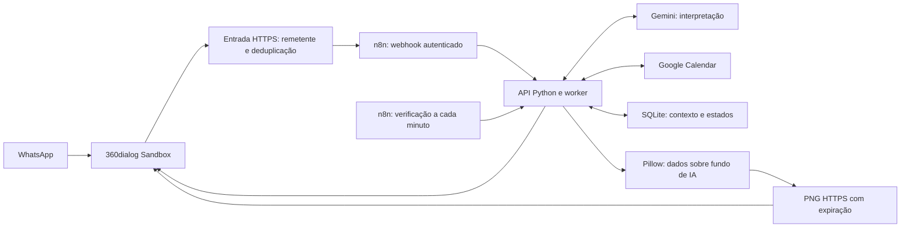

# Arquitetura implementada

A entrada restringe o remetente e registra a identidade da mensagem antes do encaminhamento. O n8n chama a API autenticada; o worker separa interpretação de execução. O modelo prepara dados, enquanto Python valida datas, conflitos, contexto e confirmações.

Criações, alterações e exclusões conservam resultados no SQLite. Uma aprovação fica vinculada à versão exata do evento e à alteração. Reagendamento e exclusão mostram prévia; a exclusão exige confirmação. Resultados incertos não são repetidos automaticamente.

O ciclo periódico sincroniza a agenda e reserva cada aviso. O card de 60 minutos usa fundo de IA reutilizado e dados por código; o aviso de 15 minutos é textual. Renderização e disponibilidade da mídia são conferidas antes do transporte, com alternativa em texto. URLs de cards expiram; dados e fusos internos permanecem exatos.
