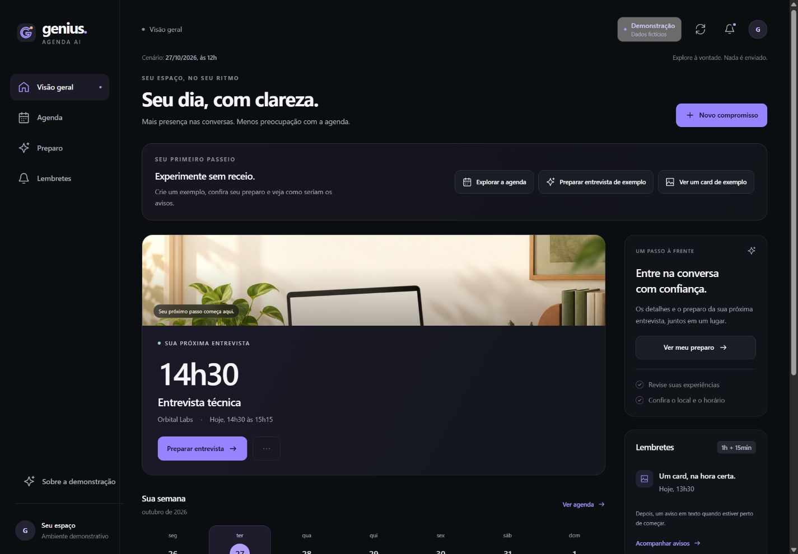
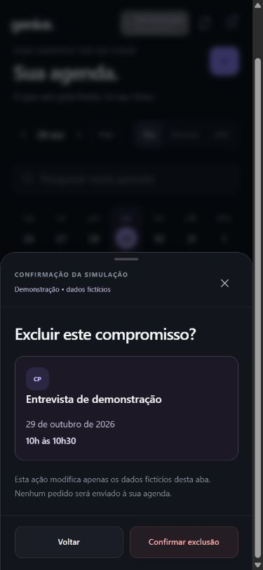

# Modo demonstração

Abra `http://127.0.0.1:8000/painel/demo/` com a API local ligada. Não é preciso autorizar o navegador, conectar contas ou configurar credenciais para explorar os exemplos. A identificação **Demonstração • dados fictícios** diferencia esse ambiente da agenda conectada.

## O que experimentar

- **Agenda:** consulte dia, semana e mês; crie um compromisso de exemplo, edite, reagende e exclua, conferindo a prévia antes de confirmar. Horários sobrepostos mostram o conflito dentro do cenário fictício.
- **Preparo:** veja o briefing com as informações de exemplo, marque o checklist, confira um resumo ilustrativo e busque horários livres. O resumo não representa uma chamada de IA.
- **Lembretes:** explore avisos pendentes, aceitos, bloqueados, incertos e cancelados; veja os motivos, o histórico e as prévias dos cards. Nenhuma mensagem é enviada.
- **Restaurar exemplos:** descarte a simulação e volte ao cenário inicial para uma nova apresentação.

As datas pertencem a um cenário fixo, identificado na própria tela. “Hoje” e “amanhã” referem-se a esse cenário, sem depender da data do computador. Isso mantém a demonstração reproduzível para quem vê o projeto depois.

## Separação dos dados reais

As alterações ficam somente na memória da aba e são perdidas ao recarregar ou restaurar os exemplos. Não há gravação em `localStorage`, `sessionStorage`, SQLite ou Google Calendar. Duas abas têm simulações independentes.

A demonstração não chama a API de agenda, Gemini, n8n ou WhatsApp. Seus recursos são arquivos locais e a política de conteúdo bloqueia conexões de dados. Os registros de envio também são simulados: **aceito pelo provedor** não significa entregue ou lido. Prévias de imagem não são comprovantes de envio.

O acesso à agenda real continua separado em `/painel/`, com o pareamento e as confirmações já existentes. Explorar a demonstração não autoriza nem revoga esse acesso.

## Abrir sem os serviços do projeto

O mesmo modo pode ser aberto por um servidor estático independente, sem iniciar a API ou configurar o `.env`:

```powershell
.\.venv\Scripts\python.exe -B scripts/preview_panel.py
```

Abra `http://127.0.0.1:8015`. Para escolher outra porta, use `--port 8016`. Encerre o servidor com `Ctrl+C`. Ele serve somente os arquivos da demonstração, no próprio computador.

[Fases do painel](painel-web.md) · [Acesso à agenda real](painel-web-api.md) · [Evidências](evidencias.md).

## Validação deste marco

Passaram **227 testes Python focados e 105 testes Node**, incluindo 21 da demonstração. O ensaio no navegador cobriu operações com confirmação, dois reagendamentos, cancelamento de prévia, conflito, histórico, preparo, reset e duas abas independentes. Desktop e celular, inclusive 320 pixels de largura, foram conferidos. O servidor independente também foi aberto no navegador.

Quinze verificações HTTP na API instalada confirmaram a separação de arquivos, as conexões bloqueadas da demo e a proteção das consultas reais. Os testes controlados não acionaram factories de provedores ou stores privados; a sessão real permaneceu igual. O ledger de lembretes instalado também não mudou. Não houve envio WhatsApp, chamada de IA ou escrita no Google. Registros 204–208 no [índice de evidências](evidencias.md).




