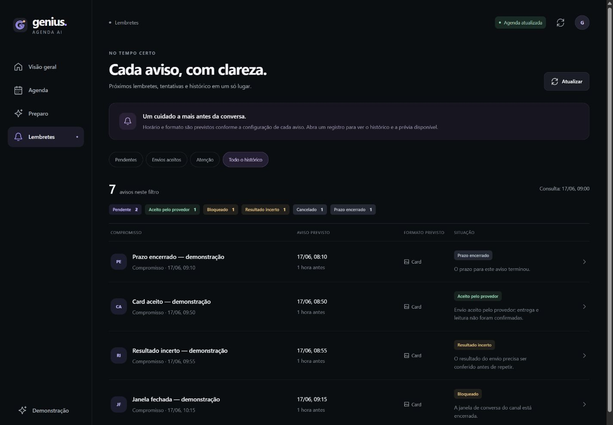
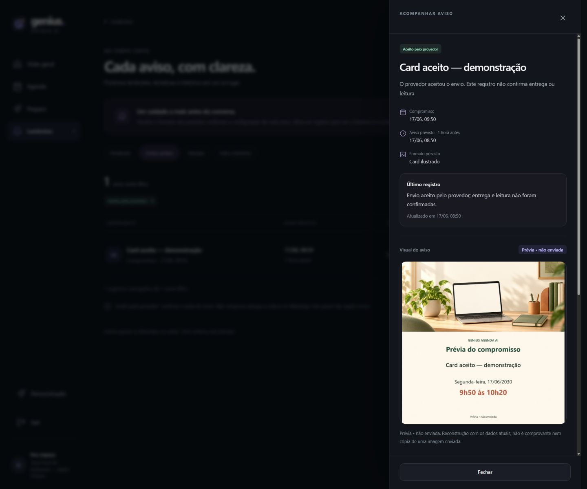

# Lembretes e prévias de cards no painel

A tela **Lembretes** acompanha os registros reais do agendador. Abrir a lista, o histórico ou a prévia não verifica novos disparos, altera a agenda ou envia mensagens.

## Estados e filtros

- **Pendentes:** avisos ainda em preparação ou aguardando o processamento. Um horário previsto que já passou não deve ser confundido com um envio concluído.
- **Envios aceitos:** o provedor aceitou a tentativa. Esse estado não comprova entrega ou leitura no WhatsApp.
- **Atenção:** avisos bloqueados, com resultado incerto ou cujo prazo terminou. O motivo é mostrado sem oferecer reenvio automático.
- **Todo o histórico:** inclui cancelamentos, alterações e os demais estados persistidos.

As contagens identificam o filtro e o conjunto consultado; a interface não transforma os primeiros itens de uma página em total de toda a agenda. O histórico conserva as transições do aviso e seus motivos. Datas e horários são apresentados no fuso da agenda, em formato legível.

## Prévia da imagem

Um aviso com formato previsto de card permite pedir uma prévia protegida. O servidor relê o evento, confere o vínculo com o registro e usa o gerador existente para compor título, data e horário sobre o fundo já aprovado. A imagem é identificada como **Prévia — não enviada**.

Essa composição usa os dados atuais e não recupera a imagem originalmente enviada. O ledger registra a aceitação de uma tentativa, mas não conserva prova do formato histórico da mídia. Por isso, **formato previsto** e **prévia** permanecem identificados.

Se o evento foi removido, mudou de horário ou não pode ser conferido, o painel mantém o histórico e explica a indisponibilidade da imagem. Avisos de texto não viram cards por causa da consulta. Uma falha de renderização mantém as informações textuais, sem publicar uma URL de mídia nem disparar uma alternativa no WhatsApp.

## Segurança e operação

A rota `GET /painel/api/reminders/{reminder_id}/card-preview` exige a sessão local do painel antes de ler o ledger, consultar o calendário ou renderizar. A resposta é um PNG privado sem cache; os arquivos temporários de composição são removidos. A prévia não chama IA nem o transporte WhatsApp.

O leitor de lembretes continua em modo SQLite somente de leitura. Os fluxos de envio e recuperação existentes não são executados pela tela. Resultados antigos de imagem não devem reaparecer depois de trocar o aviso ou encerrar a sessão.

[Acesso local](painel-web-api.md) · [Regras de lembretes](fechamento-etapa-12.md) · [Cards e limites](cards-com-ia.md) · [Evidências](evidencias.md).

## Validação deste marco

**221 testes Python focados no painel/cards e 84 testes Node aprovados.** O navegador conferiu lista, filtros, histórico, prévia privada, alternativa em texto e uso no celular com dados fictícios. Testes de sessão, corridas de respostas, limites de PNG e remoção de temporários estão incluídos.

A API instalada consultou 20 registros reais e compôs um PNG privado de 1254×1254 a partir de um evento atual do Google. Os bytes privados não foram salvos; o ledger de lembretes permaneceu byte a byte igual. Não houve escrita Google, mensagem WhatsApp ou chamada de IA. A última suíte completa de 2.684 testes Python é um resultado histórico separado. Registros 198–203 no [índice de evidências](evidencias.md).

