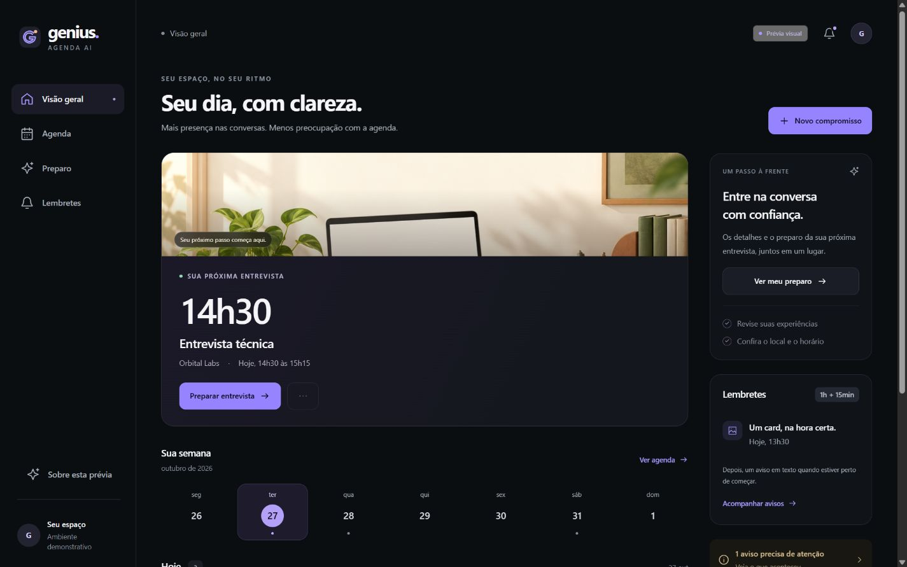
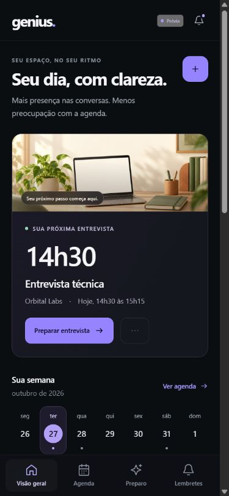

# Painel web — primeira versão visual

Registro histórico da fase 2 da etapa 15, concluída em 27/10/2026 como **protótipo local**, com quatro telas responsivas e dados fictícios. **A fase 3 já acrescentou consultas reais protegidas em `http://127.0.0.1:8000/painel/`; [documentação atual](painel-web-api.md).** Este documento, suas capturas e verificações continuam descrevendo somente a prévia fictícia, preservada em `/painel/demo/` e no servidor independente da porta 8015.



## Abrir

Na raiz do projeto:

```powershell
.\.venv\Scripts\python.exe -B scripts/preview_panel.py
```

Endereço: <http://127.0.0.1:8015>. O servidor escuta somente no próprio computador e serve `web/`; não expõe a raiz do projeto. É possível trocar a porta com `--port 8016` e encerrar com `Ctrl+C`.

HTML, CSS e módulos JavaScript nativos, sem dependências frontend, compilação ou recursos remotos. [Código e instruções](../web/README.md).

## Experiência construída

| Tela | O que pode ser experimentado |
|---|---|
| Visão geral | Próxima entrevista com imagem, dias da semana, compromissos do dia e atalhos para preparo/avisos |
| Agenda | Dia, semana e mês; pesquisa no período; detalhes; formulários e simulação de CRUD com conflito e confirmação |
| Preparo | Seleção da entrevista, contexto factual ilustrativo, checklist por evento, resumo de exemplo e três alternativas fictícias de horário |
| Lembretes | Próximos avisos, aceites, atenção e histórico; motivo e prévia de card ou texto |

No celular, a navegação fica na base e os detalhes abrem em uma folha sobre a tela. No computador, o menu fica na lateral e os detalhes entram pela direita. A troca de telas tem movimento curto e não intercepta cliques rápidos na navegação. Há foco visível, link de pular ao conteúdo, fechamento por `Esc` e alternativa de movimento reduzido.

Tema escuro, violeta pontual, tipografia legível e superfícies discretas a partir da referência do usuário. A imagem existente de `assets/cards/interview-background-v1.png` foi reutilizada. Fotos e conversas pessoais dos prints de referência não foram incluídas.



## Limites da simulação

- O selo **Prévia** permanece visível. A referência dos exemplos é 27/10/2026; não representa o estado atual de uma agenda conectada.
- Não há chamada à API, ao Gemini, ao Google, ao n8n, ao SQLite ou ao WhatsApp. A política de conteúdo bloqueia conexões da página.
- Criar, editar, reagendar e excluir afeta somente os objetos em memória dessa aba. Recarregar restaura os exemplos. As confirmações da prévia não são autorizações do backend real.
- Checklist é separado por entrevista e temporário. O resumo é ilustrativo, sem geração por IA. Os horários livres são calculados somente sobre os exemplos.
- Reagendar simula o cancelamento dos próximos avisos e prepara novos exemplos. Registros históricos conservam seu próprio título e intervalo, mesmo após mudar o compromisso.
- “Aceito pelo provedor” não se transforma em entregue/lido. Nenhuma ação da tela envia lembretes ou executa recuperação de resultados incertos.
- O menu **Sobre esta prévia** permite experimentar carregamento, ausência de resultados e falha de leitura, além de restaurar os dados fictícios.

## Verificação deste marco

Conferência no navegador das quatro telas, dos fluxos locais e dos tamanhos desktop/celular; capturas reais dos exemplos. O registro JSON desta fase separa verificações de interface, verificações estáticas/dados e respostas HTTP locais. Os números não são somados à suíte Python do backend.

Não houve nova execução dos 2.530 testes de backend neste marco: os arquivos `app/` não foram alterados. A prova visual não comprova integração com Google ou entrega de WhatsApp.

Evolução posterior registrada: a [fase 3](painel-web-api.md) concluiu o acesso local protegido e as consultas reais de agenda, detalhes e lembretes. O próximo passo é o CRUD pelo painel com confirmação vinculada. O modo demonstração completo da fase 7 continua pendente; esta prévia permanece uma base visual isolada.
